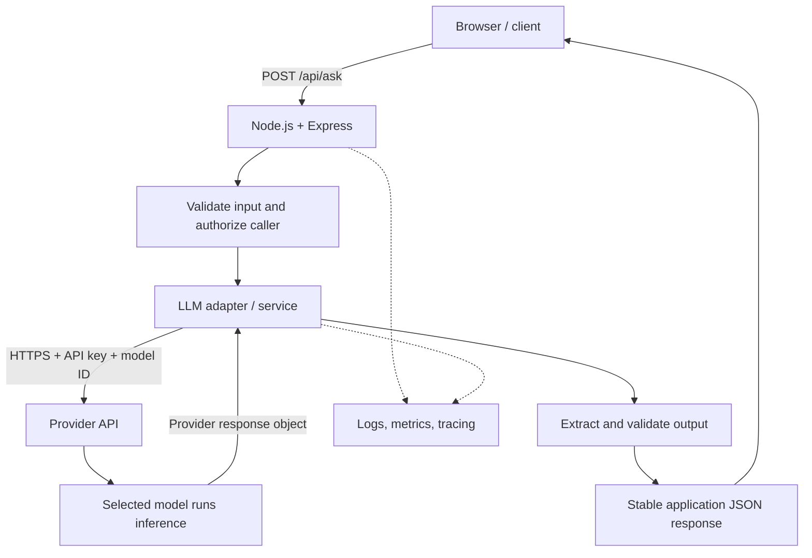
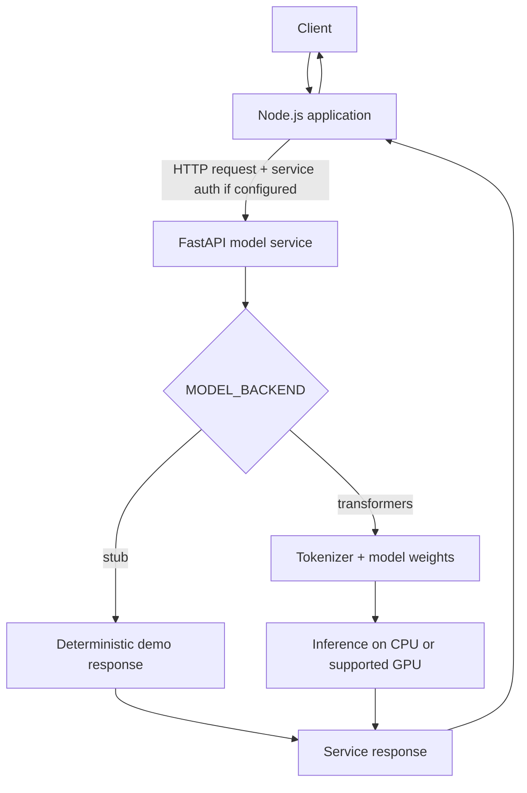

# Node.js LLM Integration: Architecture, Setup, and Runbook

This guide explains how a Node.js application integrates with a large language model (LLM), what happens during a request, how to install and run a working example, and how to handle responses and failures.

It covers two common deployment patterns:

1. **Call a hosted model provider** through its API (example: OpenAI).
2. **Call your own model service** over HTTP (for example, this repository's FastAPI service).

The model ID, request format, response schema, authentication, and supported capabilities vary by provider. The architecture is reusable, but provider-specific code is not automatically interchangeable.

## 1. Architecture

### Hosted model API



### Calling a self-hosted model service



This repository's default `MODEL_BACKEND=stub` is useful for exercising the HTTP contract, but it is not an actual LLM. Set `MODEL_BACKEND=transformers` and install the optional model dependencies to run a real local model; see the repository README.

### Responsibilities

- **Client:** Sends a question and displays the result. It must not contain a secret provider API key.
- **Node.js route:** Handles HTTP, request validation, authorization, and application response status codes.
- **LLM adapter:** Encapsulates provider-specific SDK/HTTP calls and normalizes output.
- **Provider or model service:** Authenticates the request, selects the configured model, performs inference, and returns a response.
- **Model:** Generates output from input and learned parameters. It does not automatically know your private data unless the data is supplied or connected through an approved retrieval/tool design.
- **Observability:** Tracks latency, failures, and usage. Do not log API keys or sensitive prompts by default.

## 2. What happens during a request?

1. A client sends JSON such as `{"question":"Explain recursion"}`.
2. Express parses the request and checks the input type and size.
3. The Node.js service selects a model through configuration and calls the SDK or model-service endpoint.
4. The client library sends an HTTP request. For a hosted provider, it includes authentication and usually travels over HTTPS.
5. The provider checks the key, account permissions, model ID, and usage limits.
6. The selected model processes the input and generates output tokens.
7. The provider returns a structured response object. The SDK resolves a Promise on success or throws an error on failure.
8. The adapter extracts the text (or another supported output type), validates it, and returns a normalized result.
9. Express returns an application-defined JSON response to the caller.

**Important distinction:** the API response envelope is not necessarily the model answer itself. For the OpenAI JavaScript SDK, `response.output_text` is a convenient text extraction property. The underlying `response.output` contains typed output items and is needed for more advanced workflows such as tool calls.

## 3. Prerequisites

- Node.js 20+ or a currently supported Node.js LTS version.
- npm (bundled with Node.js).
- For the hosted-provider example: an API account, a valid API key, network access, and a model ID enabled for that account.
- For a self-hosted setup: the model service must be running and reachable from Node.js.

Check your local setup:

```bash
node --version
npm --version
```

Install Node.js from <https://nodejs.org/> if either command is unavailable.

## 4. Install the Node.js example

Create a new project:

```bash
mkdir node-llm-client
cd node-llm-client
npm init -y
npm install express dotenv openai
npm pkg set type=module
npm pkg set scripts.start="node src/server.js"
npm pkg set scripts.dev="node --watch src/server.js"
mkdir src
```

Expected layout:

```text
node-llm-client/
├── .env
├── .gitignore
├── package.json
└── src/
    ├── server.js
    └── llm.js
```

## 5. Configure credentials and model

Create a `.env` file in the project root:

```dotenv
OPENAI_API_KEY=replace_with_your_real_key
OPENAI_MODEL=replace_with_a_model_id_available_to_your_account
PORT=3000
```

Create `.gitignore`:

```gitignore
node_modules/
.env
.DS_Store
```

Keep the key on the backend. Do not commit it, expose it to browser code, or paste it into logs. If it is exposed, revoke it and create a replacement. ChatGPT access does not automatically include API credits; check API billing and usage before making requests.

## 6. Implement the provider adapter

Create `src/llm.js`:

```javascript
import OpenAI from "openai";

const apiKey = process.env.OPENAI_API_KEY;
const model = process.env.OPENAI_MODEL;

if (!apiKey) throw new Error("OPENAI_API_KEY is not configured");
if (!model) throw new Error("OPENAI_MODEL is not configured");

const client = new OpenAI({
  apiKey,
  timeout: 30_000,
  maxRetries: 2,
});

export async function generateText(prompt) {
  const response = await client.responses.create({
    model,
    input: prompt,
  });

  const text = response.output_text?.trim();
  if (!text) {
    throw new Error("The model returned no text output");
  }

  return {
    text,
    model,
    usage: response.usage ?? null,
    responseId: response.id ?? null,
    requestId: response._request_id ?? null,
  };
}
```

### Why use an adapter?

The route should not depend on every detail of a provider's SDK. The adapter owns the external call, extracts the fields the application needs, and returns a predictable shape. A second adapter can later call another provider or this repository's FastAPI service while keeping the route contract stable.

This example deliberately supports text output only. Structured output, tool calls, refusals, images/audio, and streaming require additional handling. Never assume that arbitrary model-generated text is valid JSON or safe to execute.

## 7. Implement the Express API

Create `src/server.js`:

```javascript
import "dotenv/config";
import express from "express";
import { generateText } from "./llm.js";

const app = express();
const port = Number(process.env.PORT ?? 3000);

app.disable("x-powered-by");
app.use(express.json({ limit: "16kb" }));

app.get("/healthz", (_req, res) => {
  res.status(200).json({ status: "ok" });
});

app.post("/api/ask", async (req, res) => {
  const question = req.body?.question;

  if (typeof question !== "string" || !question.trim()) {
    return res.status(400).json({
      error: {
        code: "INVALID_QUESTION",
        message: "Provide a non-empty string in the question field.",
      },
    });
  }

  if (question.length > 8000) {
    return res.status(413).json({
      error: {
        code: "QUESTION_TOO_LONG",
        message: "Question must be 8000 characters or fewer.",
      },
    });
  }

  try {
    const result = await generateText(question.trim());

    return res.status(200).json({
      answer: result.text,
      model: result.model,
      usage: result.usage,
      responseId: result.responseId,
    });
  } catch (error) {
    // Log only safe operational details; never log credentials.
    console.error("LLM request failed", {
      name: error?.name,
      status: error?.status,
      requestId: error?.request_id,
    });

    // Do not leak provider internals to callers.
    return res.status(502).json({
      error: {
        code: "LLM_REQUEST_FAILED",
        message: "The AI service request failed. Please try again later.",
      },
    });
  }
});

app.listen(port, () => {
  console.log(`Server listening on http://localhost:${port}`);
});
```

### Success response contract

A successful request returns HTTP `200` and a stable JSON structure:

```json
{
  "answer": "Model-generated text goes here",
  "model": "the-configured-model-id",
  "usage": {
    "input_tokens": 12,
    "output_tokens": 80,
    "total_tokens": 92
  },
  "responseId": "provider-response-id"
}
```

The values above are illustrative. Actual usage fields depend on the SDK response and provider.

Invalid input returns `400`:

```json
{
  "error": {
    "code": "INVALID_QUESTION",
    "message": "Provide a non-empty string in the question field."
  }
}
```

Provider failures return a generic `502` response to the client. Production code may map known provider errors to more specific application errors while avoiding leakage of secrets or internal details.

## 8. Start and test

Start the service from the project root:

```bash
npm start
```

Expected startup log:

```text
Server listening on http://localhost:3000
```

Check health:

```bash
curl http://localhost:3000/healthz
```

Expected:

```json
{"status":"ok"}
```

Send a prompt:

```bash
curl -X POST http://localhost:3000/api/ask \
  -H 'Content-Type: application/json' \
  -d '{"question":"Explain recursion in programming with a JavaScript example."}'
```

The answer will vary by model and request. For development auto-restart, use:

```bash
npm run dev
```

## 9. Connect Node.js to this repository's FastAPI service

If you run this repository's service locally, Node.js can call its OpenAI-compatible chat endpoint instead of using the hosted OpenAI API. Start the FastAPI service according to the root README, then test it directly:

```bash
curl -X POST http://127.0.0.1:8000/v1/chat/completions \
  -H 'Content-Type: application/json' \
  -d '{"messages":[{"role":"user","content":"Explain causal attention"}],"max_tokens":100}'
```

A minimal Node.js call to that service looks like this:

```javascript
const response = await fetch("http://127.0.0.1:8000/v1/chat/completions", {
  method: "POST",
  headers: { "Content-Type": "application/json" },
  body: JSON.stringify({
    messages: [{ role: "user", content: "Explain causal attention" }],
    max_tokens: 100,
  }),
});

if (!response.ok) {
  throw new Error(`Model service returned HTTP ${response.status}`);
}

const data = await response.json();
// OpenAI-compatible chat-completion shape:
console.log(data.choices?.[0]?.message?.content);
```

This endpoint's response schema is chat-completions style, which differs from the hosted OpenAI Responses API. Confirm the actual schema from this service's implementation or `/docs` before relying on it. The local service's default stub backend is a demo response, not a real LLM.

## 10. Error handling and troubleshooting

- **Missing API key:** Ensure `.env` is in the project root and restart the process after changing it.
- **401 authentication error:** Check that the key is valid and belongs to the intended API project.
- **Model not found / access denied:** Verify the exact model ID and account permissions.
- **429 quota/rate limit:** Check billing, usage limits, and rate limits. Avoid immediate unbounded retry loops.
- **Timeout/network failure:** Use a bounded timeout and retry only transient failures. The SDK may retry some temporary failures automatically.
- **Empty output:** Treat it as a handled condition. Inspect the response structure in a secure development environment if needed.
- **Port already in use:** Change `PORT` in `.env`, for example to `3001`.
- **Local model service unreachable:** Verify the FastAPI process, host/port, container networking, and service readiness.
- **Unexpected response shape:** Check which API endpoint and schema are being used; do not mix Responses API fields with Chat Completions fields.

## 11. Production hardening checklist

Before exposing this API to users:

- Add authentication and authorization to your own Express endpoint.
- Apply per-user/tenant rate limits and concurrency limits.
- Keep API keys in deployment secrets or a secret manager.
- Enforce input size limits, request timeouts, and bounded retries.
- Monitor latency, error rates, token usage, and cost; configure provider budget alerts.
- Avoid logging sensitive prompts, model output, or credentials unless explicitly required and governed.
- Validate model output before using it in business workflows.
- Never run generated code or execute tool calls without allowlists, authorization, and strict validation.
- Add tests for validation, successful responses, empty outputs, and provider failures.
- Consider streaming for interactive applications; this example waits for the full response.
- For self-hosted inference, plan model warm-up, memory/GPU capacity, concurrency, and shutdown behavior.
- Review provider retention/privacy settings before sending sensitive data.

## 12. Supporting multiple providers

A common application interface can look like this:

```javascript
const result = await llm.generateText(prompt);
// normalized application result: { text, model, usage, responseId }
```

Each provider adapter translates that common call into the provider's SDK or HTTP format and maps the result back to the application schema. Keep provider-specific details in adapters rather than spreading them through route handlers.

Not every provider supports every feature in the same way. Tool calling, JSON-schema constrained output, streaming, multimodal input, and usage reporting need capability checks and provider-specific implementation.

## 13. Official references

- OpenAI API platform: https://platform.openai.com/
- OpenAI API keys: https://platform.openai.com/api-keys
- OpenAI Responses API: https://platform.openai.com/docs/guides/text
- OpenAI JavaScript SDK: https://github.com/openai/openai-node
- Node.js: https://nodejs.org/
- Express: https://expressjs.com/
- Ollama API: https://docs.ollama.com/api

## Summary

The `model` field selects a model supported by the provider. Node.js sends the input, awaits the provider response, extracts and validates the relevant output, and returns a stable contract to the client. A small adapter layer isolates provider-specific code and makes it easier to switch between hosted APIs and a self-hosted model service.
